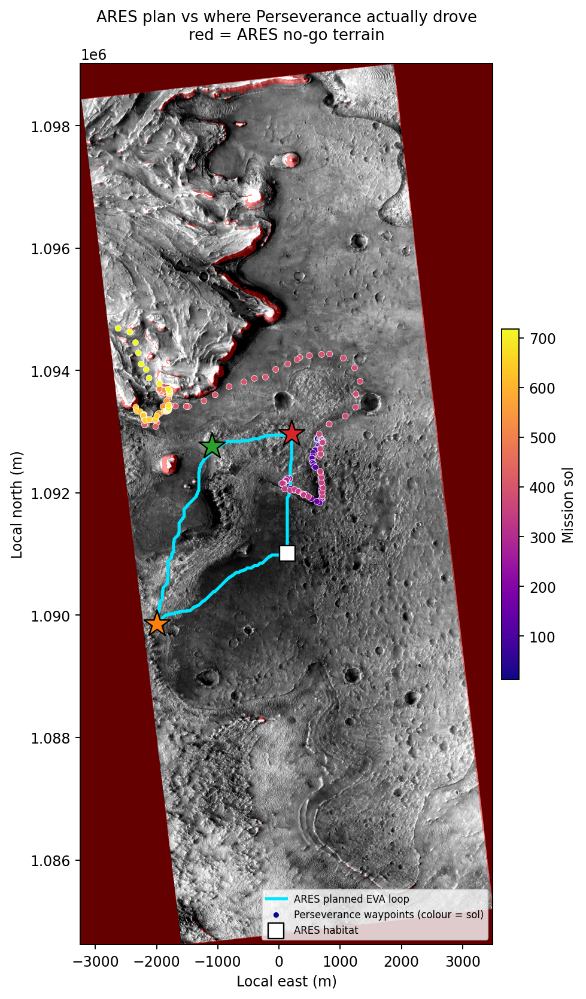

# 🔴 ARES — THE FIRST MARSWALK, PLANNED

### Adaptive Reconnaissance & Expedition System

**A data-driven mission-planning experience for a future human EVA at Jezero Crater.**

*NASA Space Apps Challenge 2026 · Mars Marswalk · Jezero Crater*

---

  

> **The challenge:** A crew walking on Mars cannot rely on GPS or a global map. They need a local plan that connects terrain, hazards, science targets, time, and the journey home.

## 🚀 Judge walkthrough — start here

**[Launch the live ARES mission experience →](https://ares-mars-mission-d4yz.onrender.com)**

1. **Mission brief** — understand why human-scale terrain intelligence matters.
2. **NASA data stack** — see how orbital imagery, topography, spectroscopy and rover observations contribute.
3. **Interactive 3D terrain lab** — rotate the Jezero terrain preview and inspect planned route and science-stop markers.
4. **EVA mission replay** — watch the route unfold; inspect distance, elapsed time, slope, elevation and reference dose; toggle no-go terrain and the Perseverance traverse.
5. **Safety and scientific integrity** — distinguish measured inputs, derived products and planning assumptions.
6. **Scientific notebook** — inspect the reproducible analysis behind the experience.

The 3D surface is an explanatory visualization. Quantitative route and hazard analysis comes from the notebook terrain products and mission dataset.

## 🧭 Project summary

ARES (Adaptive Reconnaissance & Expedition System) turns NASA orbital data into a hyperlocal planning tool for a human Marswalk at Jezero Crater. It layers HiRISE 1 m terrain and imagery, CRISM spectral summary parameters and MOLA elevation, screens terrain by slope and hazard, selects 3 spectral science stop(s), and plans a least-cost walking loop from a habitat site: 9.24 km with an estimated 4.17 h EVA, inside the assumed 8.0 h limit, a maximum slope of 8.2 degrees and a maximum walk-back distance of 4.62 km. Every output is labelled measured, derived or assumed, and the route is a planning prototype rather than a certified safe traverse. The hazard model is checked against 261 NASA Perseverance waypoints (0.8% fall in ARES no-go terrain), and nearest rover images show the crew what to expect.

## 📊 Mission snapshot

| Planning output | Current project result |
|---|---:|
| Planned route | **9.24 km** |
| Estimated EVA duration | **4.17 h** |
| Assumed EVA time limit | **8.0 h** |
| Maximum slope along route | **8.2°** |
| Maximum walk-back distance | **4.62 km** |
| Perseverance waypoints used for comparison | **261** |
| Waypoints falling in ARES no-go terrain | **0.8%** |
| Spectral science stops | **3** |

These are supplied project results, not independently certified operational limits. See the notebook and mission data for calculations and assumptions.

## 🛰️ NASA data field

- **MRO HiRISE** — Jezero digital terrain model and orthoimage products ESP_045994_1985 / ESP_046060_1985.
- **MRO CRISM** — MTRDR HRL000040FF summary parameters and IN mask, accessed via the PDS Mars Orbital Data Explorer.
- **MGS MOLA** — MEGDR regional topography for elevation context.
- **Mars 2020 Perseverance** — raw image feed and rover traverse waypoints from mars.nasa.gov and MMGIS.
- **Mars 2020 MEDA** — weather feed, where retrieved and available in the analysis build.

| Source | Mission-planning role |
|---|---|
| HiRISE imagery | Fine-scale visual context |
| HiRISE DTM | Local elevation and derived slope |
| CRISM summary parameters | Spectral indicators used to prioritize science stops |
| MOLA MEGDR | Regional topographic context |
| Perseverance imagery and waypoints | Nearby visual context and rover-path comparison |
| MEDA | Environmental context when retrieved |

CRISM indices identify spectral targets for investigation; they do not, by themselves, prove mineral identity.

## 🗺️ Mission visuals

 <em>Planned EVA route and mission geography.</em>

 <em>ARES hazard screening compared with Perseverance rover traverse observations.</em>

The repository also includes the underlying basemap, no-go mask, mission JSON and three nearby Perseverance point-of-view images in the data/ directory.

## 🔬 Reproducibility

- [Open the final mission-planning notebook](notebook/ARES_Martian_Mission_Planner_FINAL.ipynb)
- [Inspect the mission dataset](data/mission.json)
- [Inspect the route map](data/ares_route_map.png)
- [Inspect the dashboard](data/ares_mission_dashboard.png)

The notebook documents the analysis workflow and produces the mission products consumed by the website. The interactive site reads the mission JSON and local image assets to present the route and its context.

## ⚖️ Scientific integrity & limitations

- **Measured:** source imagery, elevation products, spectral parameters and rover observations.
- **Derived:** slope, hazard screening, selected science stops, least-cost route and EVA estimates.
- **Assumed:** operational thresholds, walking speed, stop duration and planning constraints.

ARES is a **planning prototype, not a certified safe traverse**. The route depends on stated assumptions and available data. Rock-scale hazards below the terrain-model resolution, suit effects, thermal loads and live space weather are not fully modelled. The Perseverance comparison is a useful external check on the hazard map, but a rover is not a suited astronaut and its path does not certify human safety. MEDA weather context is included only where successfully retrieved.

## 🖼️ Project-page image checklist

| Image | Supplied size | Repository status |
|---|---:|---|
| ares_mission_dashboard.png | 0.78 MB | Present |
| ares_rover_vs_ares.png | 1.31 MB | Present |
| ares_perseverance_pov.png | 1.70 MB | Not in current repository tree |
| ARES_integrated_surface_atlas.png | 2.66 MB | Not in current repository tree |
| ares_route_map.png | 1.42 MB | Present |
| ares_route_profile.png | 0.12 MB | Not in current repository tree |

All supplied sizes are below the stated 10 MB project-page limit. The repository also contains pov_1.jpg, pov_2.jpg and pov_3.jpg as individual rover-view assets. Add the three missing PNGs before linking them from the project page.

## 🎬 Video

[Watch the ARES project video on YouTube](https://m.youtube.com/watch?v=CZ2nQl5CsOQ&pp=iggUQAFKEEhLdWJubjhseUVPZnNrQUk%3D&ra=m)

## 👩‍🚀 Team

Umar Tabbsum · Aiden Janes · Luke Korth · Viralbhai Patel

---

NASA data acknowledgements: MRO HiRISE, MRO CRISM, MGS MOLA, Mars 2020 Perseverance and MEDA instrument/data teams, NASA/JPL-Caltech and the Planetary Data System.

No NASA logos or mission identifiers are used. This project is not endorsed by NASA.

**Code license:** MIT. See [LICENSE](LICENSE).