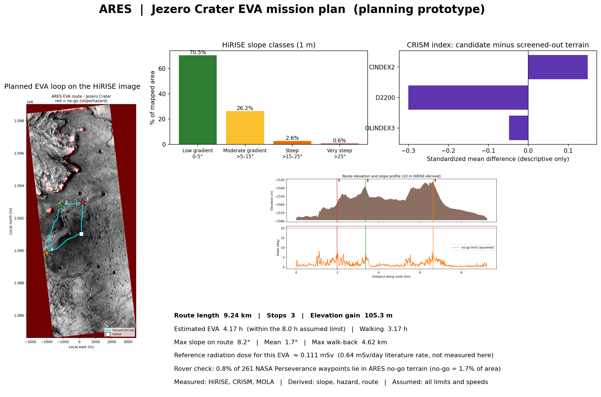
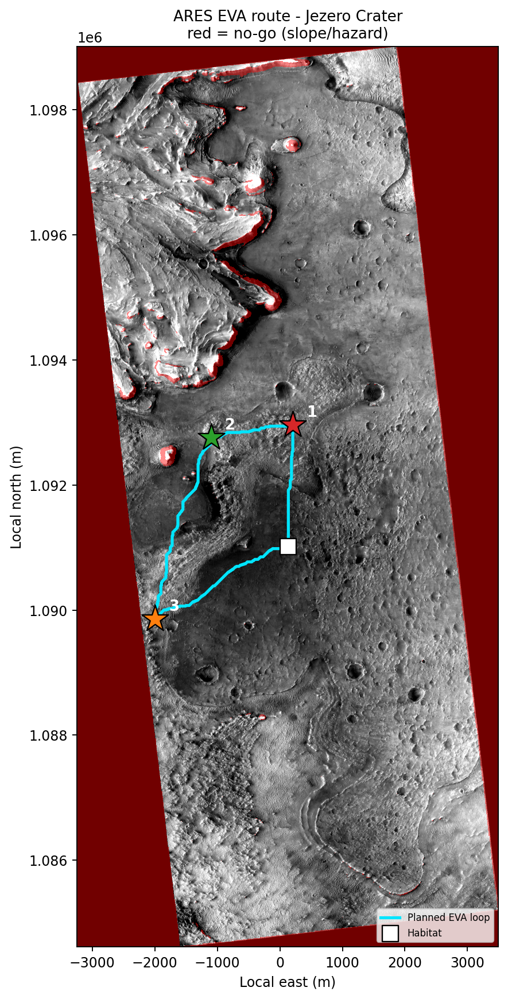
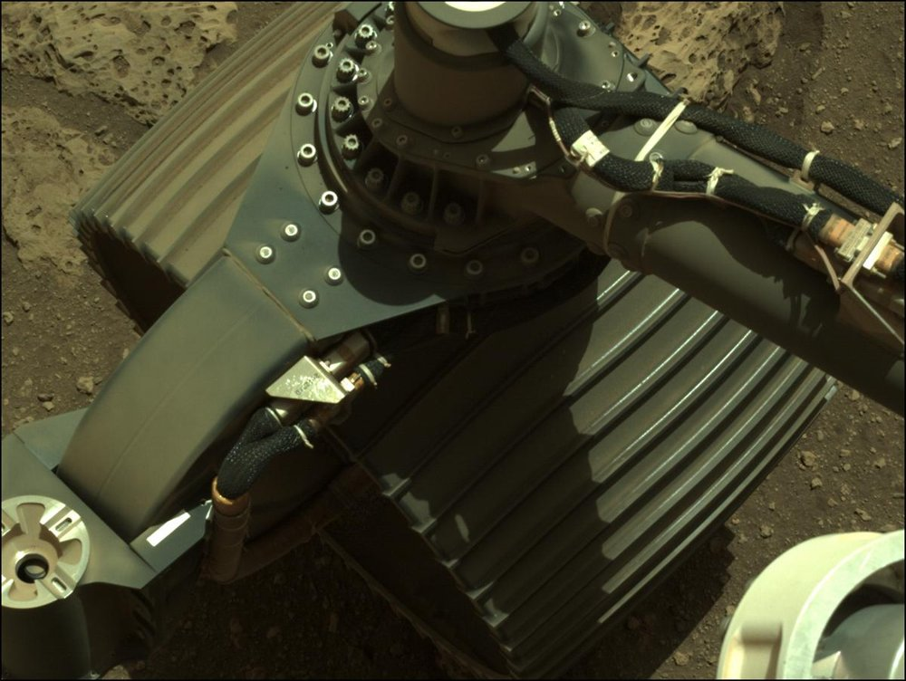
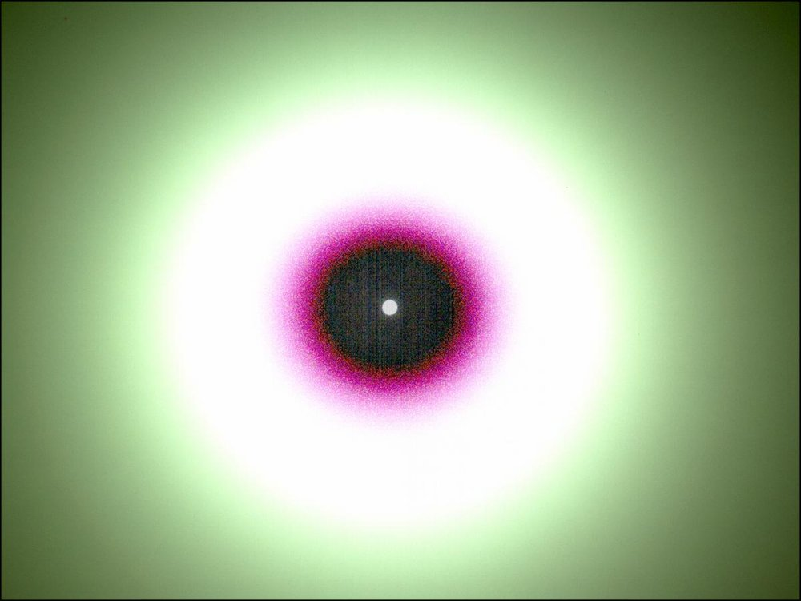
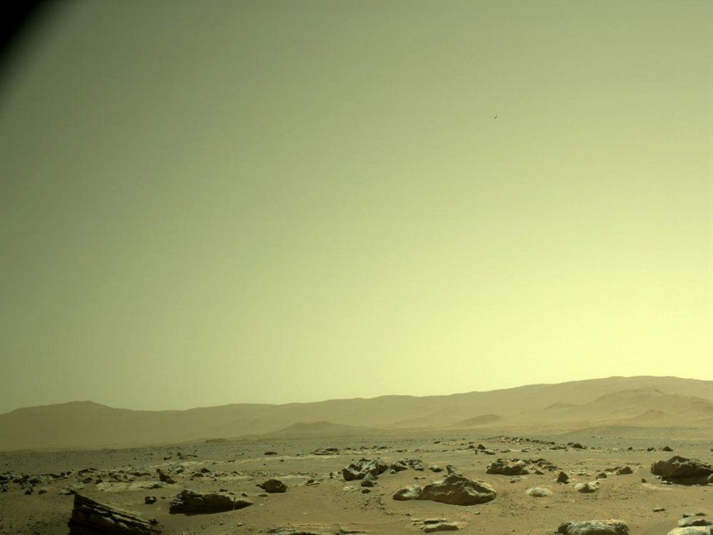

# 🔴 ARES — THE FIRST MARSWALK, PLANNED

### Adaptive Reconnaissance & Expedition System

**A data-driven mission-planning experience for a future human extravehicular activity (EVA) at Jezero Crater, Mars.**

*NASA Space Apps Challenge 2026 · Interplanetary Survival Guide · Jezero Crater*

Mars animation: “Spinning Mars” by JOGOS Public Assets, CC BY-SA 4.0. <a href="https://commons.wikimedia.org/wiki/File:Spinning_Mars.gif">Source and license</a>.

---

  

> **The problem:** A crew exploring Mars cannot depend on GPS or a global navigation map. It needs a local plan that brings together terrain, hazards, science objectives, EVA time, and a viable route back to the habitat.

## 🚀 Judge walkthrough

**Suggested time: 5–7 minutes.** Open the live experience first, then use the notebook and mission data to inspect how the planning outputs were produced.

1. **Launch the mission.** Open the [ARES Live Mission Experience](https://ares-mars-mission-d4yz.onrender.com). Start with the mission brief and identify the planning problem: connect a habitat, science stops, terrain constraints, and a return route.
2. **Explore the data context.** Review the NASA data sources: HiRISE imagery and elevation, CRISM spectral summary parameters, MOLA regional topography, and Perseverance imagery and traverse waypoints. Each source contributes a different kind of context.
3. **Inspect the 3D terrain.** Open the **3D Terrain Lab**. Rotate and zoom the terrain, reset the view, and examine available overlays. This is an explanatory terrain visualization; quantitative slope and hazard calculations are described in the analysis.
4. **Replay the EVA.** Open the **EVA Mission Replay** and follow the planned loop from the habitat through the selected science stops and back. Inspect distance, elapsed time, slope, elevation, and walk-back context. Compare the route with the no-go terrain and rover-traverse overlays where available.
5. **Examine the science and hazards.** Review the three selected spectral science stops and the hazard-screening view. Consider what terrain and spectral evidence informed the stop selection, how slope screening affects route choice, and how the plan accounts for the return journey. CRISM parameters identify targets for investigation; they do not independently prove mineral identity.
6. **Check the mission metrics.** Compare the live experience with the mission snapshot below. The current plan is 9.24 km with an estimated 4.17-hour EVA, a maximum route slope of 8.2°, and a maximum walk-back distance of 4.62 km, against an assumed 8-hour planning limit.
7. **Verify the analysis.** Open the [final scientific notebook](notebook/ARES_Martian_Mission_Planner_FINAL.ipynb) and inspect the data preparation, terrain and hazard analysis, route planning, and outputs. The [mission JSON](data/mission.json) provides structured mission data used by the web experience.

**The central idea:** ARES connects orbital science data to a human-scale EVA planning workflow and makes the route, evidence, and assumptions explorable.

## 🧭 Project overview

ARES (Adaptive Reconnaissance & Expedition System) is a prototype for planning a future human Marswalk in Jezero Crater. It combines orbital terrain and spectral information with rover context to screen terrain, prioritize potential science stops, and calculate a least-cost route from a proposed habitat location.

The workflow uses HiRISE imagery and digital terrain data, CRISM spectral summary parameters, and MOLA elevation context. It screens terrain using slope and hazard criteria, identifies three spectral science targets, and plans a 9.24 km loop. The estimated EVA duration is 4.17 hours under the project's stated assumptions. The route has a maximum slope of 8.2° and a maximum walk-back distance of 4.62 km.

The hazard-screening output is compared with 261 Perseverance traverse waypoints; 0.8% of those waypoints fall within the ARES no-go terrain classification. This comparison is an external context check, not a human-safety validation.

## 📊 Mission snapshot

| Planning output | Project result |
|---|---:|
| Planned route | **9.24 km** |
| Estimated EVA duration | **4.17 h** |
| Assumed EVA planning limit | **8.0 h** |
| Maximum slope along route | **8.2°** |
| Maximum walk-back distance | **4.62 km** |
| Perseverance waypoints used for comparison | **261** |
| Waypoints falling in ARES no-go terrain | **0.8%** |
| Selected spectral science stops | **3** |

These are project outputs, not certified operational limits. Values depend on the data, model resolution, thresholds, and assumptions documented in the notebook and mission data.

## 🛰️ NASA data sources

- **MRO HiRISE** — Jezero digital terrain model and orthoimage products ESP_045994_1985 and ESP_046060_1985.
- **MRO CRISM** — MTRDR HRL000040FF summary parameters and IN mask, accessed through the PDS Mars Orbital Data Explorer.
- **MGS MOLA** — MEGDR regional topography for elevation context.
- **Mars 2020 Perseverance** — rover imagery and traverse waypoints from NASA and MMGIS sources.
- **Mars 2020 MEDA** — weather context where retrieved and available in the analysis build.

| Data source | Role in ARES |
|---|---|
| HiRISE imagery | Fine-scale visual surface context |
| HiRISE digital terrain model | Local elevation and derived slope |
| CRISM summary parameters | Spectral indicators used to prioritize science targets |
| MOLA MEGDR | Regional topographic context |
| Perseverance imagery and waypoints | Nearby visual context and rover-path comparison |
| MEDA | Environmental context where available |

CRISM summary parameters are indicators for investigation, not definitive mineral identifications.

## 🗺️ Mission visuals

### Planned EVA route

  

<em>Planned route and mission geography.</em>

### Hazard-screening comparison

  

<em>ARES no-go terrain classification compared with Perseverance traverse observations. The comparison provides context; it does not certify a human route as safe.</em>

### No-go terrain mask

  

<em>Terrain classified as no-go by the project's hazard-screening method.</em>

### Perseverance surface views

  
  
  

<em>Three rover point-of-view images included as nearby surface context. They are not observations of every location along the proposed ARES route.</em>

The `data/` directory also contains the basemap (`basemap.jpg`), mission data (`mission.json`), and the dashboard, route, comparison, no-go, and rover-view images shown above.

## 🔬 Reproducibility and project files

- [Scientific notebook](notebook/ARES_Martian_Mission_Planner_FINAL.ipynb) — analysis workflow and planning outputs.
- [Mission data](data/mission.json) — structured data consumed by the interactive experience.
- [Live mission experience](https://ares-mars-mission-d4yz.onrender.com) — interactive presentation of the mission plan.
- [Dashboard image](data/ares_mission_dashboard.png) — overview of the mission experience.
- [Route map](data/ares_route_map.png) — planned EVA route.
- [Hazard comparison](data/ares_rover_vs_ares.png) — comparison with Perseverance traverse context.

The notebook documents the analysis workflow; the website presents the mission data and associated visual assets. Consult the notebook for methodological details and assumptions rather than treating the dashboard as a substitute for the analysis.

## ⚖️ Scientific integrity and limitations

ARES distinguishes between:

- **Measured inputs:** source imagery, elevation products, spectral parameters, and rover observations.
- **Derived outputs:** slope, hazard screening, selected science stops, least-cost route, and EVA estimates.
- **Assumptions:** operational thresholds, walking speed, stop duration, and planning constraints.

**ARES is a planning prototype, not a certified safe traverse or an operational mission system.** Important limitations include:

- The planning grid and source datasets have different native spatial resolutions; a 10 m planning cell does not mean every input measurement has 10 m resolution.
- Rock-scale hazards and other features smaller than the source terrain data may not be represented.
- Suit effects, human factors, thermal loads, and live space-weather conditions are not fully modelled.
- Walking speed, operational thresholds, stop duration, and the 8-hour EVA limit are planning assumptions.
- CRISM spectral indicators prioritize areas for investigation but do not confirm mineral identity.
- Perseverance is a rover, not a suited astronaut. Its traverse history provides useful context but cannot validate human safety.
- MEDA weather context is included only where the relevant data were successfully retrieved.

These limitations are part of the project's scope and should be considered when interpreting its outputs.

## 🎬 Project video

[Watch the ARES project video on YouTube](https://m.youtube.com/watch?v=CZ2nQl5CsOQ&pp=iggUQAFKEEhLdWJubjhseUVPZnNrQUk%3D&ra=m)

## 👩‍🚀 Team

Umar Tabbsum · Aiden Janes · Luke Korth · Viralbhai Patel

---

**NASA data acknowledgements:** MRO HiRISE, MRO CRISM, MGS MOLA, Mars 2020 Perseverance and MEDA instrument/data teams, NASA/JPL-Caltech, and the Planetary Data System.

This project is not endorsed by NASA. No NASA logos or mission identifiers are used.

**Code license:** MIT. See [LICENSE](LICENSE).
